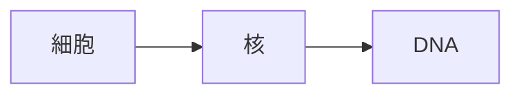

# 赤シート暗記ノート PWA

教材の太字を赤シートで隠して覚え、一問一答で確認する日本語PWA。GoogleログインとD1の許可リストで利用者を制限します。ビルド・外部ライブラリは不要ですが、認証の初期設定が必要です。

## Cloudflare Pagesへの公開

1. Cloudflareの「Workers & Pages」から **Pages** のGitリポジトリ連携を選ぶ。
2. `lemonydrink/memory_PWA` を選択。
3. 本番ブランチ `main`、フレームワーク `None`、ビルドコマンドは空欄、出力ディレクトリは **public** に設定。
4. **[Googleログインの設定](docs/google-auth.md)** に従い、D1・Google OAuth・Pagesのシークレットを設定してデプロイします。未設定のままでは503で停止します。以後mainへのpushで更新されます。

Wranglerを使用する場合は `npx wrangler pages deploy public --project-name memory-pwa`。このリポジトリはPages用です。

## 利用方法

- サンプルノートから赤シート・テストを試せます。メニューから一覧へ戻れます。
- `.redsheet.md` または画像を同梱した `.redsheet.zip` を読み込みます（24 MiB以内）。
- ノート・画像・フォルダはIndexedDBに保存されます。同じURL・同じブラウザの保存領域で利用します。
- フォルダ作成、ノートの名前変更・移動に対応。
- 「バックアップ保存」で画像を含む全データをJSONファイルに保存。「復元」で置き換えます。復元前に現在のバックアップを保存してください。
- iPhoneはSafariの共有メニューから「ホーム画面に追加」。オンラインで権限を確認すると最大3日間のオフライン利用許可を発行します。準備後はオフライン起動・教材読み込み・学習が可能です。期限を過ぎるとオンラインでの確認が必要です。
- Safariとホーム画面アプリでは保存領域が分かれる場合があります。JSONバックアップで移してください。
- サイトデータ削除で教材も消えるため、定期的にバックアップしてください。

## 教材の例

```markdown
# 生物の基本

## 学習

生物の基本単位は**細胞**です。

## テスト

### 生物の基本単位は？

細胞
```

画像付きZIPは直下に `note.redsheet.md`、画像を `assets/` 配下に配置。PNG/JPEGに対応。

## ローカル確認

```sh
npx wrangler pages dev public --config wrangler.example.toml --d1 DB=your-database-id
```

本番のGoogle OAuth・Secure Cookieを含む確認は、HTTPSの設定済み環境で行ってください。単純な静的HTTPサーバーでは認証は動きません。`.dev.vars.example` は環境設定のひな形です。

## 元仕様との差分

添付の仕様は `docs/original-spec.md` に保存しています。現版はGoogle OAuthとD1の許可リストでアクセスを制限します。Cookieによるログイン保持は最大90日です。Cloudflare Access、操作ログは未実装です。教材はアカウント別に端末内へ保存し、「教材のアップロード」画面の「クラウドと同期」で明示的にR2へ保存・復元します。同期するまで端末の変更はサーバーに反映されません。

バックアップは独自JSON形式で、元仕様のバックアップZIPとの互換性はありません。ノート単位の書き出しは未対応です。教材の追加はファイル読み込みで行います。

署名付きのオフライン利用許可は最大72時間かつログインセッションの期限内です。利用許可の失効は再接続時または許可期限までに反映します。旧版のオフライン端末は次回オンライン更新まで旧版を開ける場合があります。詳しくは認証設定の移行手順を確認してください。

## 検証

- `gjs tests/parser.js`：教材の正常・異常入力。
- `python3 tests/run_browser.py auth`：Google/D1を模擬したOAuth・署名・許可リスト・Cookie・失効テスト（Chrome/Chromium・Pythonのcryptographyが必要）。
- `python3 tests/run_browser.py app`：認証後の表示、表、テスト、アカウント別保存、画像付き同期、署名付きオフライン再起動のブラウザ確認。

テスト用の認証APIはPythonのローカルテストサーバー内に限定され、本番には含みません。実際のGoogleログインは設定済みのHTTPS環境で別途確認してください。

## Markdownの表

学習本文とテストの問題補足・答え・解説で、パイプ区切りの表を表示できます。セル内の太字と画像に対応し、学習本文の太字は赤シートで隠せます。幅の広い表は横スクロールできます。

```markdown
| 構造 | 働き |
| :--- | :--- |
| **核** | DNAを含む |
| **ミトコンドリア** | ATPをつくる |
```

区切り行はハイフン3個以上。`:---` は左、`:---:` は中央、`---:` は右揃えです。外側のパイプは省略でき、セル内のパイプは `\|` と書きます。セル内改行・セル結合には未対応です。

## 手動クラウド同期とオフライン

「＋ 読み込む」またはメニューからアップロード画面を開きます。「クラウドと同期」で状態を確認し、初回や内容の競合時は保存・復元する方向を選択します。空の新端末からクラウドを自動上書きしません。クラウドから復元する際は確認と端末内の退避を行い、「同期前の端末データへ戻す」で取り消せます。

画像を含むバックアップは1件50 MiB以内。クラウドは最新＋過去9件まで保存します。アプリからの復元は最新分、過去世代は管理者がR2から取得します。同期はライブラリ全体の置き換えで、ノート単位の自動マージや自動同期はしません。

[追加設定（署名鍵・R2）](docs/google-auth.md#3日間のオフライン利用とr2同期の追加設定) が必要です。オフライン利用許可とキャッシュは端末側にも保存されるため、ブラウザのサイトデータ削除などで失われる場合があります。

保存済みの画面ファイルはキャッシュを優先して使い、再ダウンロードを抑えます。オンライン時は利用権限の軽量な確認を行います。オフライン利用許可は残り24時間未満の場合に再発行します。完全に通信を止めたい場合は、オフライン準備完了後に機内モードなどを使用してください。

## テスト画面の操作

画面上の空白を上にスワイプすると「問題 → 解答 → 次の問題」と進みます。下にスワイプすると一つ前の表示へ戻ります。長い問題・解説は本文や画像の上からスクロールしてください。タップ用の「答えを表示」「次の問題」「戻る」ボタンと、上下矢印キーも利用できます。

赤シートはヘッダー直下から画面下部まで4段階で調節できます。ドラッグ後は離した位置に最も近い段階へ収まり、位置はノートごとにセッション中保持します。つまみのタップで一段ずつ上げ、最上段からは最下段へ戻ります。つまみにフォーカスした状態で上下矢印・Home・Endキーも利用できます。

利用権限は10分ごとにバックグラウンドで確認します。確認中に問題・読書位置・赤シートの位置をリセットしません。10分以内の画面復帰では定期確認を繰り返しません。

赤シートの色が重なっている本文も、その上から通常の縦スクロールができます。上端48pxの中央部分はつまみ操作、その下20pxは誤操作防止の無反応帯です。上端48pxのつまみ外側も無反応とし、その下から本文スクロールになります。

## 数式（TeX）と図（Mermaid）

KaTeX 0.19.1とMermaid 12.3.0を同梱しています。Safari 17.4以降、または最近のChrome/Firefoxを使用してください。外部CDN・描画APIへの接続は不要です。学習本文、表のセル、テストの問題補足・答え・解説で使えます。

```markdown
# シグマの公式

## 学習

整数の和は **$\frac{n(n+1)}{2}$** です。

$$
\sum_{k=1}^{n} k = \red{\frac{n(n+1)}{2}}
$$

| 数列 | 和 |
| --- | --- |
| $1+2+\cdots+n$ | **$\frac{n(n+1)}{2}$** |

## テスト

### $\sum_{k=1}^{n} k$ は？

$\frac{n(n+1)}{2}$
```

インライン数式は同じ行の `$…$`、独立した数式は `$$…$$` を使用します。`**$…$**` は数式全体、`\red{…}` は数式の指定部分を赤シートの対象にします。テスト側では `\red` も通常色で表示します。数式中にMarkdownの `**` を入れず、`\red` を使ってください。テストの質問見出しでもインライン数式を表示できます。

図は次のようなコードブロックで記述します。

````markdown

````

フローチャートのノードに `:::red`（または `class B red`）を付けると、そのラベルを赤い穴埋めとして扱います。枠は黒いままで、ラベルの下線も残します。テストではラベルを隠しません。フローチャート・シーケンス図などMermaidの通常の図に対応し、外部画像・外部アイコン・クリック動作・教材内の設定上書きは無効です。TeX／図の構文に誤りがある場合は、その箇所に元の記法とエラー案内を表示し、ほかの教材は表示を続けます。

ライブラリと全数式フォントは、オフライン準備時にバージョン別の専用キャッシュへ保存します。画面用キャッシュを更新しても、ライブラリのバージョンが同じなら再ダウンロードしません。教材のバックアップ／同期には元のTeX・Mermaidテキストを保存し、生成したSVGや数式HTMLは保存しません。

サイズ・ライセンス・再取得方法は [THIRD_PARTY_NOTICES.md](THIRD_PARTY_NOTICES.md) を参照してください。

## ノートの削除

ノート一覧の「…」→「ノートを削除」から、対象名を確認して削除できます。削除は端末への保存が成功してから反映し、付属画像とセッション中の進行状態も削除対象になります。フォルダやほかのノートは保持します。クラウドには「クラウドと同期」で端末の変更を保存したときに反映します。必要な教材は削除前にファイルバックアップを保存してください。

## メモリ・安全性の確認

画像・数式付き教材の反復切り替え、描画要素と画像URLの解放、起動失敗からの再試行、ログアウトと認証確認の競合を検証するには `python3 tests/run_browser.py memory` を実行します。隔離したChromeでGC後のヒープ量も測定します。検証結果と適用範囲は [安全性検証記録](docs/safety-review-2026-11-07.md) を参照してください。
