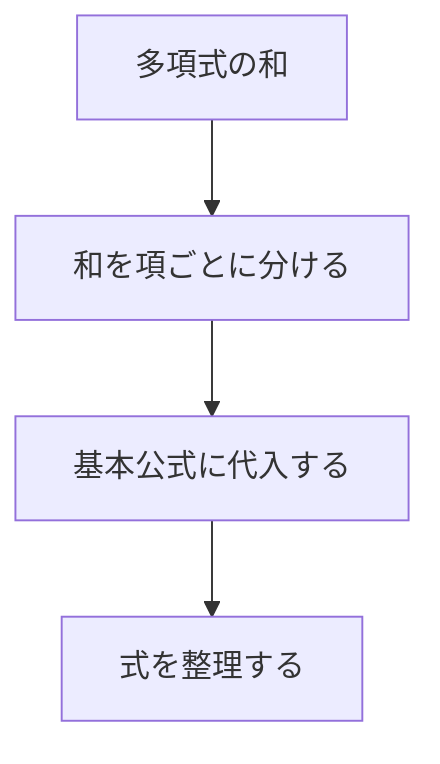

# 数式と図の赤シート見本

## 学習

### 整数の和

$1$ から $n$ までの整数の和は **$\frac{n(n+1)}{2}$** です。

式の右辺だけを赤シートで隠せます。

$$
\sum_{k=1}^{n} k = \red{\frac{n(n+1)}{2}}
$$

### 二乗と三乗の和

| 足す項 | 和の公式 |
| :--- | :--- |
| $k^2$ | **$\frac{n(n+1)(2n+1)}{6}$** |
| $k^3$ | **$\left(\frac{n(n+1)}{2}\right)^2$** |

### 計算の流れ

図の「基本公式に代入する」だけが赤い暗記対象になります。

### 計算例

$$
\sum_{k=1}^{n}(3k+2)
=3\frac{n(n+1)}{2}+2n
=\red{\frac{n(3n+7)}{2}}
$$

## テスト

### $\sum_{k=1}^{n} k$ の公式は？

$\frac{n(n+1)}{2}$

### $\sum_{k=1}^{n} k^2$ の公式は？

$\frac{n(n+1)(2n+1)}{6}$

### $\sum_{k=1}^{n} k^3$ の公式は？

$\left(\frac{n(n+1)}{2}\right)^2$

### 多項式の和はどのように計算する？

和を項ごとに分け、基本公式に代入して整理します。

#### 解説

